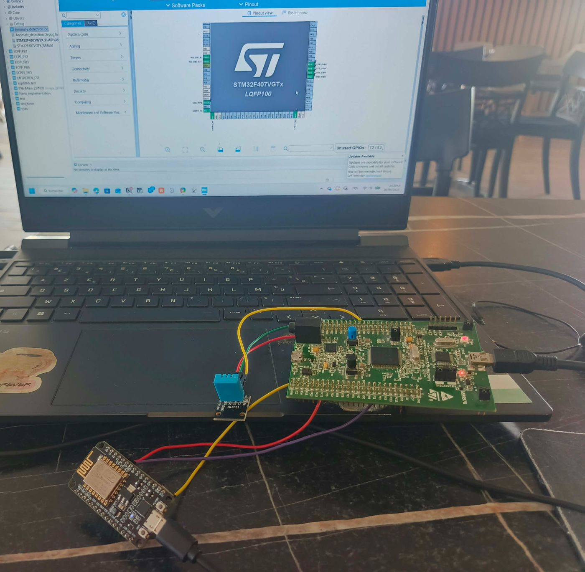
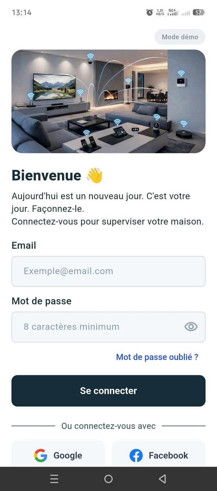
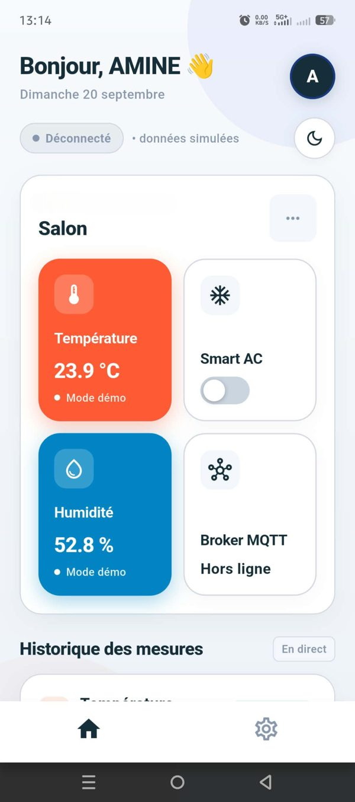

# Connected Home Automation System

> Control the lights, the blinds and the air conditioning of a home from a phone, with an STM32 at the heart of it.

I built this during my engineering internship at CSF. The goal was simple to state and surprisingly rich to build: take a microcontroller, give it Wi-Fi, and make it talk to a mobile app, a smart-home hub and eventually a voice assistant.

It is a work in progress. Some parts are finished and tested, others are still on the bench. I say which is which below.



*The real setup on my desk: the STM32F407 Discovery board, the ESP8266 (NodeMCU) for Wi-Fi, and the temperature/humidity sensor.*

---

## What it should do

The brief had three requirements:

1. **Control** lighting, blinds and air conditioning from a mobile app.
2. **Voice control** through Google Assistant.
3. **Automation scenarios** that react on their own (for example, to the temperature).

## How it works

The idea is to keep each piece small and test it on its own before wiring it to the next one.

```
STM32F407  <--UART/AT-->  ESP8266  --Wi-Fi-->  MQTT broker  -->  Home Assistant  -->  Google Assistant
                                                    |
                                                    +--> Flutter mobile app / Node-RED dashboard
```

- **STM32F407 (Discovery board)** reads the sensors and runs the firmware, written in C with STM32CubeIDE and HAL.
- **ESP8266 (ESP-01)** only does one job: it gives the STM32 access to Wi-Fi. They talk over UART with AT commands.
- **MQTT** carries the messages. HiveMQ's public broker during development, Mosquitto in Docker for the local setup.
- **Home Assistant** is meant to be the central hub, and the bridge to Google Assistant.
- **Flutter app** shows live data and will send commands.
- **Node-RED** gives me quick dashboards while I develop.

### MQTT topics

| Topic | Direction | Purpose |
|---|---|---|
| `nsiri/temperature` | device to app | Temperature reading |
| `nsiri/humidite` | device to app | Humidity reading |
| `nsiri/commande/led` | app to device | Turn an LED on or off (test actuator) |
| `nsiri/commande/clim` | app to device | Air conditioning on/off and setpoint (16-30 °C) |

## Tech stack

- **Firmware:** C, STM32CubeIDE, STM32CubeMX, HAL
- **Microcontroller:** STM32F407VGT6 (replaced the ESP32 I started with)
- **Connectivity:** ESP8266 / ESP-01 in AT command mode, MQTT (PubSubClient on the ESP side)
- **Sensor:** DHT22 (temperature and humidity)
- **Edge AI:** NanoEdge AI for anomaly detection on the sensor data
- **Mobile app:** Flutter / Dart, `mqtt_client`, `fl_chart`
- **Tools:** Node-RED, Docker, Mosquitto, Home Assistant, Hercules (UART monitor)

## Where things stand

**Working**

- DHT22 readings on the STM32.
- Data flowing from the STM32 to the ESP8266 and out to the MQTT broker.
- A Flutter dashboard that connects to the broker and draws live temperature and humidity charts. Tested on a real Android phone.
- NanoEdge AI integrated in the firmware, with two phases: it first learns what "normal" looks like, then flags readings that drift away from it.

**In progress**

- Commands going the other way: Node-RED, MQTT, ESP8266, UART, STM32 (LED first).
- Air conditioning controls in the app.

**Still ahead**

- Relays for lighting and blinds, a servo for the air conditioning.
- Mosquitto and Home Assistant as the real hub, replacing the public broker.
- Google Assistant voice control.

## The Flutter app

The dashboard shows temperature and humidity as rolling line charts. The next version adds a sign-in screen (a placeholder for now, no real authentication), a light/dark theme switch, a screen to configure the MQTT connection, and the air-conditioning control.

### Screenshots

<p align="center">
  
  &nbsp;&nbsp;&nbsp;
  
</p>

The app is in French. On the left, the sign-in screen (still a placeholder). On the right, the dashboard for the living room: temperature, humidity, the air-conditioning switch and the MQTT broker status. These screenshots were taken in **demo mode**, which feeds the dashboard with simulated values. It is handy when the broker or the hardware is not around.

## What I learned the hard way

A few things cost me hours. If you build something similar, they might save you some.

- **Check your timer clock.** On the STM32F407 Discovery running on the internal oscillator without PLL, the APB1 timer clock is 8 MHz, not 84 MHz. My TIM2 prescaler had to be 7, not 83, to get a 1 µs tick. Getting this wrong made the firmware freeze.
- **Never call `HAL_Delay()` inside an interrupt callback.** The EXTI interrupt had a higher priority than SysTick, so the delay never ended. I wrote my own timer-based delay instead.
- **CubeMX erases your code.** Regenerating the project wipes anything outside the `USER CODE BEGIN` / `END` blocks. Put your code inside them.
- **DHT11 and DHT22 are not interchangeable.** The start signal timing is different (about 18 ms vs about 1.3 ms), and so is the data scaling. Mix them up and the reads fail silently, with no error to tell you why.
- **NodeMCU pin labels lie.** `D1` is GPIO5 and `D2` is GPIO4. The TX/RX pins are tied to the USB chip, so you cannot share them.
- **SoftwareSerial and Wi-Fi fight on the ESP8266.** Disabling Wi-Fi sleep (`WiFi.setSleepMode(WIFI_NONE_SLEEP)`) fixed it for me.
- **NanoEdge AI learns on the device.** The CSV files on the PC are only used to pick the best algorithm. The actual training happens on the microcontroller, with live data.

## Getting started

<!-- TODO: fill in with your real repo structure and steps -->

1. Flash the firmware on the STM32 with STM32CubeIDE.
2. Wire the ESP8266 and the DHT22 as described in the hardware notes.
3. Set your Wi-Fi credentials and broker address (never commit them).
4. Run the Flutter app with `flutter run`.

## About

Built by **Amine Nsiri**, mechatronics engineering student at ENISo (Sousse, Tunisia).

- GitHub: [AmineNsiri001](https://github.com/AmineNsiri001)
- LinkedIn: [amine-nsiri](https://www.linkedin.com/in/amine-nsiri)
